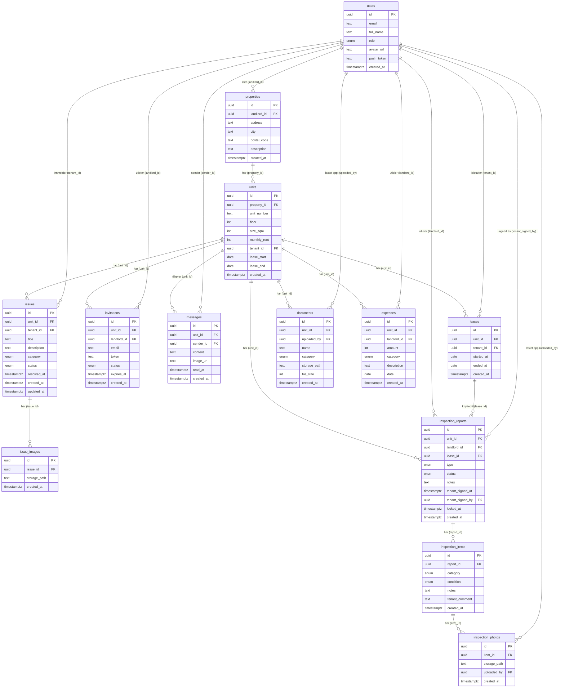

# Database – BoligDialog

PostgreSQL via Supabase. Alle tabeller har Row Level Security aktivert.

---

## ER-Diagram



---

## Tabeller

### `users`
| Kolonne | Type | Beskrivelse |
|---|---|---|
| `id` | uuid PK | Supabase Auth UID |
| `email` | text | E-postadresse |
| `full_name` | text | Fullt navn |
| `role` | enum | `landlord` eller `tenant` |
| `avatar_url` | text? | Profilbilde-URL |
| `push_token` | text? | Expo push-token |
| `created_at` | timestamptz | |

---

### `properties`
| Kolonne | Type | Beskrivelse |
|---|---|---|
| `id` | uuid PK | |
| `landlord_id` | uuid FK → users | Eier |
| `address` | text | Gateadresse |
| `city` | text | By |
| `postal_code` | text | Postnummer |
| `description` | text? | Valgfri beskrivelse |
| `created_at` | timestamptz | |

---

### `units`
| Kolonne | Type | Beskrivelse |
|---|---|---|
| `id` | uuid PK | |
| `property_id` | uuid FK → properties | |
| `unit_number` | text | Enhetsnummer (f.eks. "1A") |
| `floor` | int? | Etasje |
| `size_sqm` | int? | Størrelse i m² |
| `monthly_rent` | int? | Månedlig leie (kr) |
| `tenant_id` | uuid FK → users? | Aktiv leietaker (cache) |
| `lease_start` | date? | |
| `lease_end` | date? | |
| `created_at` | timestamptz | |

> `tenant_id` er en cache for raskt oppslag. `leases`-tabellen er sannhetskilden.

---

### `leases`
| Kolonne | Type | Beskrivelse |
|---|---|---|
| `id` | uuid PK | |
| `unit_id` | uuid FK → units | |
| `tenant_id` | uuid FK → users | |
| `started_at` | date | Innflyttingsdato |
| `ended_at` | date? | Utflyttingsdato — NULL = aktivt leieforhold |
| `created_at` | timestamptz | |

**Bruk:** Opprettes automatisk når leietaker aksepterer invitasjon. `ended_at` settes når utleier avslutter leieforholdet. Gir full historikk over alle leietakere per enhet.

---

### `invitations`
| Kolonne | Type | Beskrivelse |
|---|---|---|
| `id` | uuid PK | |
| `unit_id` | uuid FK → units | |
| `landlord_id` | uuid FK → users | |
| `email` | text | E-post til invitert leietaker |
| `token` | text | Unik token for invitasjonslenke |
| `status` | enum | `pending`, `accepted`, `expired` |
| `expires_at` | timestamptz | |
| `created_at` | timestamptz | |

---

### `issues`
| Kolonne | Type | Beskrivelse |
|---|---|---|
| `id` | uuid PK | |
| `unit_id` | uuid FK → units | |
| `tenant_id` | uuid FK → users | Innmelder |
| `title` | text | |
| `description` | text | |
| `category` | enum | `plumbing`, `electrical`, `windows_doors`, `other` |
| `status` | enum | `open`, `in_progress`, `resolved` |
| `resolved_at` | timestamptz? | |
| `created_at` | timestamptz | |
| `updated_at` | timestamptz | |

---

### `issue_images`
| Kolonne | Type | Beskrivelse |
|---|---|---|
| `id` | uuid PK | |
| `issue_id` | uuid FK → issues | |
| `storage_path` | text | Sti i Supabase Storage |
| `created_at` | timestamptz | |

---

### `messages`
| Kolonne | Type | Beskrivelse |
|---|---|---|
| `id` | uuid PK | |
| `unit_id` | uuid FK → units | Hvilken enhet samtalen gjelder |
| `sender_id` | uuid FK → users | |
| `content` | text | |
| `image_url` | text? | Bildevedlegg |
| `read_at` | timestamptz? | NULL = ulest |
| `created_at` | timestamptz | |

---

### `documents`
| Kolonne | Type | Beskrivelse |
|---|---|---|
| `id` | uuid PK | |
| `unit_id` | uuid FK → units | |
| `uploaded_by` | uuid FK → users | |
| `name` | text | Filnavn |
| `category` | enum | `contract`, `rules`, `receipt`, `other` |
| `storage_path` | text | |
| `file_size` | int | Bytes |
| `created_at` | timestamptz | |

---

### `expenses`
| Kolonne | Type | Beskrivelse |
|---|---|---|
| `id` | uuid PK | |
| `unit_id` | uuid FK → units | |
| `landlord_id` | uuid FK → users | |
| `amount` | int | Beløp (kr) |
| `category` | enum | `maintenance`, `repair`, `utilities`, `insurance`, `tax`, `other` |
| `description` | text | |
| `date` | date | |
| `created_at` | timestamptz | |

---

### `inspection_reports`
| Kolonne | Type | Beskrivelse |
|---|---|---|
| `id` | uuid PK | |
| `unit_id` | uuid FK → units | |
| `landlord_id` | uuid FK → users | |
| `lease_id` | uuid FK → leases? | Knytter rapporten til ett bestemt leieforhold |
| `type` | enum | `move_in` eller `move_out` |
| `status` | enum | `draft` → `sent_to_tenant` → `tenant_responded` → `locked` |
| `notes` | text? | Generell merknad |
| `tenant_signed_at` | timestamptz? | |
| `tenant_signed_by` | uuid FK → users? | |
| `locked_at` | timestamptz? | |
| `created_at` | timestamptz | |

---

### `inspection_items`
| Kolonne | Type | Beskrivelse |
|---|---|---|
| `id` | uuid PK | |
| `report_id` | uuid FK → inspection_reports | |
| `category` | enum | `kitchen`, `bathroom`, `floors`, `walls`, `other` |
| `condition` | enum? | `good`, `fair`, `poor` |
| `notes` | text? | Utleiers notat |
| `tenant_comment` | text? | Leietakers kommentar |
| `created_at` | timestamptz | |

---

### `inspection_photos`
| Kolonne | Type | Beskrivelse |
|---|---|---|
| `id` | uuid PK | |
| `item_id` | uuid FK → inspection_items | |
| `storage_path` | text | |
| `uploaded_by` | uuid FK → users? | Skiller utleiers og leietakers bilder |
| `created_at` | timestamptz | |

---

## Statusflyt — inspeksjonsrapport

```
draft ──► sent_to_tenant ──► tenant_responded ──► locked
  │              │                   │                │
  │         Leietaker           Utleier          Ingen kan
  │         kommenterer         låser            endre
  │         og signerer         rapporten
  │
Utleier fyller ut
rom og bilder
```

## Leiesyklus

```
invitations (pending)
      │  Leietaker aksepterer
      ▼
leases (ended_at = NULL)  ←──── aktiv
units.tenant_id = user.id
      │
      │  Utleier avslutter
      ▼
leases (ended_at = dato)  ←──── historikk
units.tenant_id = NULL
```

## Relasjoner

```
users (1) ──< properties (1) ──< units (1) ──< leases
                                          (1) ──< invitations
                                          (1) ──< messages
                                          (1) ──< issues (1) ──< issue_images
                                          (1) ──< documents
                                          (1) ──< expenses
                                          (1) ──< inspection_reports (1) ──< inspection_items (1) ──< inspection_photos
```
