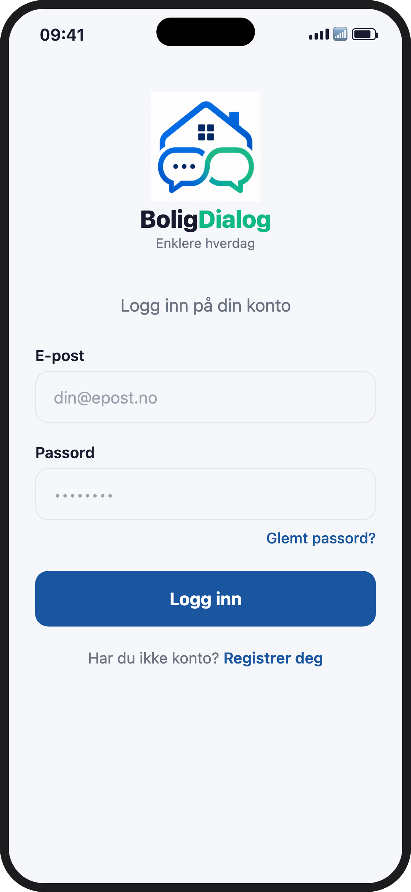
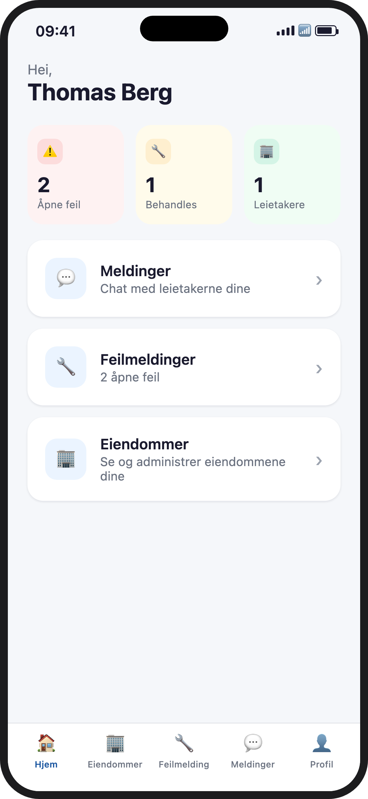
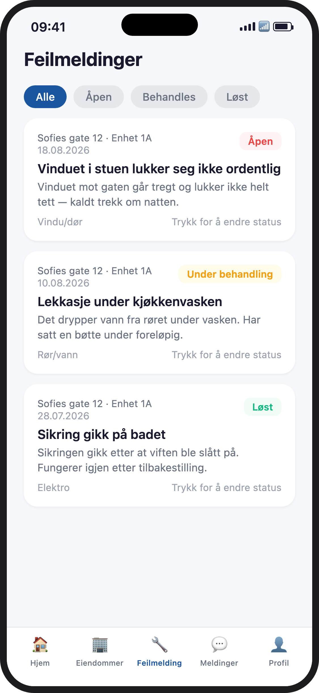
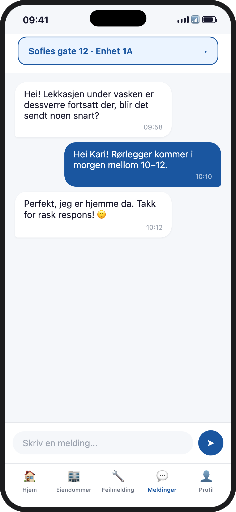
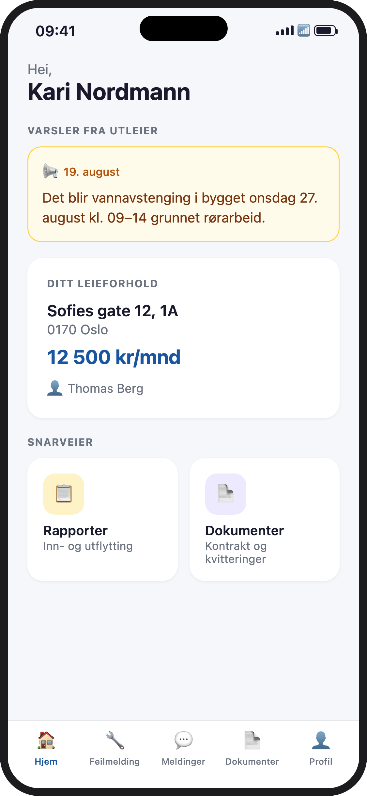
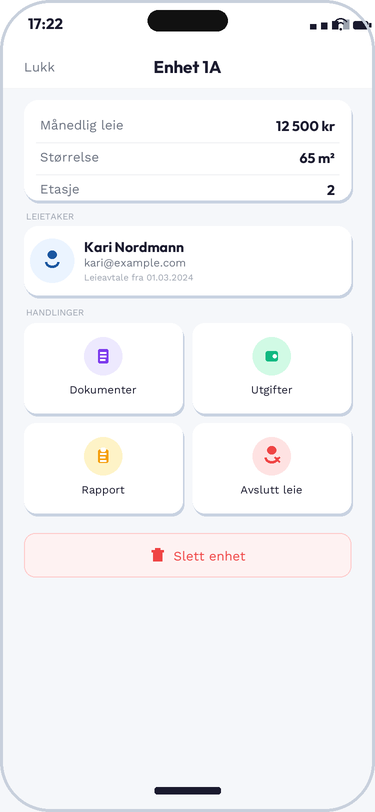
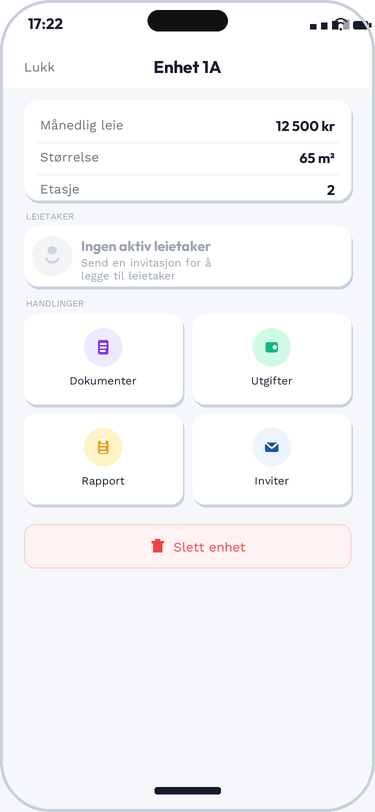

# BoligDialog

🚧 **Under utvikling** — ikke publisert ennå

Norsk mobil-app som samler all kommunikasjon mellom utleier og leietaker på ett sted — meldinger, feilmeldinger, dokumenter, rapporter og leiehistorikk, med sanntidsoppdateringer.

---

## Skjermbilder

<table>
  <tr>
    <td align="center" width="20%"><br/><sub>Innlogging</sub></td>
    <td align="center" width="20%"><br/><sub>Dashboard (utleier)</sub></td>
    <td align="center" width="20%"><br/><sub>Feilmeldinger</sub></td>
    <td align="center" width="20%"><br/><sub>Meldinger</sub></td>
    <td align="center" width="20%"><br/><sub>Hjem (leietaker)</sub></td>
  </tr>
  <tr>
    <td align="center"><br/><sub>Enhetsdetaljer</sub></td>
    <td align="center"><br/><sub>Enhet uten leietaker</sub></td>
  </tr>
</table>

> Skjermbildene viser design og datamodell med fiktivt eksempeldata (ingen ekte bruker- eller leietakerdata).

---

## Om prosjektet

BoligDialog løser et konkret problem for private utleiere: kommunikasjon med leietakere er i dag spredt over SMS, e-post og løse Word-dokumenter. Appen samler det i to skreddersydde grensesnitt — ett for utleier, ett for leietaker — bygget rundt de samme dataene i sanntid.

**Utleier** får oversikt over alle eiendommer og enheter, kan invitere leietakere med en kode, følge opp feilmeldinger med statusflyt, chatte per enhet, og gjennomføre inn-/utflyttingsrapporter med bilder og signering.

**Leietaker** får ett sted å melde feil, se kontrakt og kvitteringer, chatte med utleier, og signere rapporter digitalt.

---

## Funksjoner

### Utleier
| Funksjon | Skjerm | Beskrivelse |
|---|---|---|
| Dashboard | `(landlord)/index` | Stat-kort (åpne feil, behandles, leietakere) + snarveier |
| Eiendommer | `(landlord)/properties` | Liste over alle eiendommer |
| Eiendomsdetaljer | `(landlord)/property/[id]` | Enheter, leietakere, dokumenter, utgifter, rapporter |
| Leiehistorikk | `property/[id]` (modal) | Alle tidligere og aktive leietakere per enhet med periode og varighet |
| Avslutt leieforhold | `property/[id]` (modal) | Setter ended_at på lease og fjerner leietaker fra enhet |
| Feilmeldinger | `(landlord)/issues` | Alle feil på tvers av eiendommer med statusfilter |
| Meldinger | `(landlord)/messages` | Chat per enhet med ulest-badge og sanntidsoppdatering |
| Rapporter | `(landlord)/inspection` | Opprett inn-/utflyttingsrapporter med bilder per rom |
| Dokumenter | `property/[id]` (modal) | Last opp kontrakter, husregler og kvitteringer per enhet |
| Utgifter | `property/[id]` (modal) | Registrer og spor utgifter per enhet |
| Fellesvarsler | `property/[id]` | Send kunngjøring til alle leietakere i en eiendom |
| Profil | `(landlord)/profile` | Brukerinfo og utlogging |

### Leietaker
| Funksjon | Skjerm | Beskrivelse |
|---|---|---|
| Hjem | `(tenant)/index` | Varsler, leieforhold-info, snarvei til feilmelding og meldinger |
| Feilmeldinger | `(tenant)/issues` | Rapporter feil med bilde og følg status |
| Meldinger | `(tenant)/messages` | Chat direkte med utleier |
| Dokumenter | `(tenant)/documents` | Se og last ned dokumenter delt av utleier |
| Rapporter | `(tenant)/inspections` | Gjennomgå, kommenter, last opp bilder og signer rapporter |
| Profil | `(tenant)/profile` | Brukerinfo og utlogging |

---

## Teknologi

| Lag | Teknologi |
|---|---|
| Frontend | React Native + Expo SDK 56 |
| Routing | Expo Router v3 (filbasert) |
| Backend / DB | Supabase (PostgreSQL + Auth + Storage) |
| Sanntid | Supabase Realtime (Postgres Changes) |
| Tilstand | Zustand |
| Skjemavalidering | React Hook Form + Zod |
| Ikoner | @expo/vector-icons (Ionicons) |
| Autentisering | Supabase Auth med SecureStore |
| Testing | Jest + jest-expo |

---

## Prosjektstruktur

```
boligdialog/
├── app/
│   ├── _layout.tsx              # Root layout — auth-guard, splash, routing
│   ├── (auth)/                  # Login, registrering, glemt passord
│   ├── invite/[token].tsx       # Invitasjonsaksept — oppretter lease
│   ├── (landlord)/
│   │   ├── _layout.tsx          # Tab-navigator (5 tabs) + unread-badge
│   │   ├── index.tsx            # Dashboard
│   │   ├── properties.tsx       # Eiendomsliste
│   │   ├── property/[id].tsx    # Enhet, leietaker, historikk, docs, utgifter
│   │   ├── issues.tsx           # Feilmeldinger
│   │   ├── messages.tsx         # Meldinger
│   │   ├── inspection.tsx       # Inn-/utflyttingsrapporter
│   │   └── profile.tsx          # Profil
│   └── (tenant)/
│       ├── _layout.tsx          # Tab-navigator (6 tabs)
│       ├── index.tsx            # Hjem
│       ├── issues.tsx           # Feilmeldinger
│       ├── messages.tsx         # Meldinger
│       ├── documents.tsx        # Dokumenter
│       ├── inspections.tsx      # Rapporter
│       └── profile.tsx          # Profil
├── components/
│   ├── Icon.tsx                 # Gjenbrukbare ikonkomponenter
│   └── ProfileScreen.tsx        # Delt profilskjerm
├── lib/
│   ├── supabase.ts              # Supabase-klient med SecureStore-adapter
│   └── types.ts                 # TypeScript-typer + Database-interface
├── stores/
│   └── authStore.ts             # Zustand: session, user, loading, signOut
├── assets/                      # Bilder og ikoner
├── screenshots/                 # Skjermbilder brukt i denne READMEen
├── supabase/
│   └── migrations.sql           # Database-migrasjoner
└── landing/
    └── index.html               # Landingsside
```

---

## Kom i gang

### Forutsetninger

- Node.js 18+
- [Expo CLI](https://docs.expo.dev/get-started/installation/)
- [EAS CLI](https://docs.expo.dev/eas/) — `npm install -g eas-cli`
- Supabase-prosjekt (se [supabase.com](https://supabase.com))
- Apple Developer-konto (for TestFlight/App Store)
- iOS Simulator / Android Emulator, eller Expo Go på fysisk enhet

### Installasjon

```bash
git clone <repo-url>
cd boligdialog
npm install
```

### Miljøvariabler

Kopier `.env.example` og fyll inn verdiene:

```bash
cp .env.example .env
```

```env
EXPO_PUBLIC_SUPABASE_URL=https://<ditt-prosjekt>.supabase.co
EXPO_PUBLIC_SUPABASE_ANON_KEY=<din-anon-nøkkel>
```

> ⚠️ `.env` skal aldri committes. Legg produksjonsvariabler inn i EAS Secrets.

### Database

Kjør migrasjonen i Supabase SQL Editor:

```bash
# Lim inn innholdet i supabase/migrations.sql
```

### Start appen (lokal utvikling)

```bash
npx expo start
```

---

## Bygg og distribusjon

### EAS Build

Logg inn og koble til Expo-prosjektet:

```bash
eas login
eas init   # første gang — oppretter prosjekt-ID på expo.dev
```

Legg til miljøvariabler som EAS Secrets (gjøres én gang):

```bash
eas secret:create --scope project --name EXPO_PUBLIC_SUPABASE_URL --value <verdi>
eas secret:create --scope project --name EXPO_PUBLIC_SUPABASE_ANON_KEY --value <verdi>
```

### TestFlight

```bash
# Bygg for iOS TestFlight
eas build --platform ios --profile preview

# Send til TestFlight automatisk etter bygg
eas submit --platform ios --profile production
```

### App Store

```bash
# Produksjonsbygg
eas build --platform ios --profile production

# Submit til App Store Connect
eas submit --platform ios --profile production
```

> Fyll inn `ascAppId` og `appleTeamId` i `eas.json` før submit.

---

## Veikart

- [ ] Push-varsler for nye meldinger og feilmeldinger
- [ ] Android-testing og -lansering
- [ ] Betalingsintegrasjon for husleie
- [ ] Eksport av rapporter til PDF

---

## Om utvikleren

Laget av **Iselin Trondsen**, frontend-utvikler.

[](https://github.com/iselintrondsen)
[](https://linkedin.com/in/iselin-trondsen)
[](mailto:iselintrondsen@hotmail.com)

---

## Miljø

Appen krever to miljøvariabler via `EXPO_PUBLIC_`-prefiks. Sensitiv konfigurasjon (service role key) skal **aldri** legges i klientkoden.

---

## Lisens

Privat prosjekt — alle rettigheter forbeholdt.
